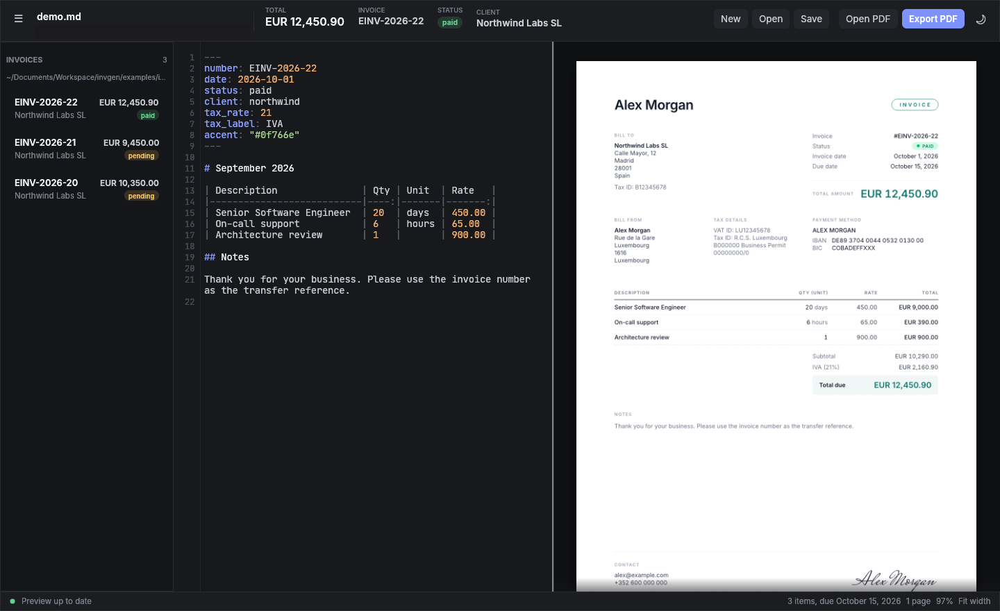
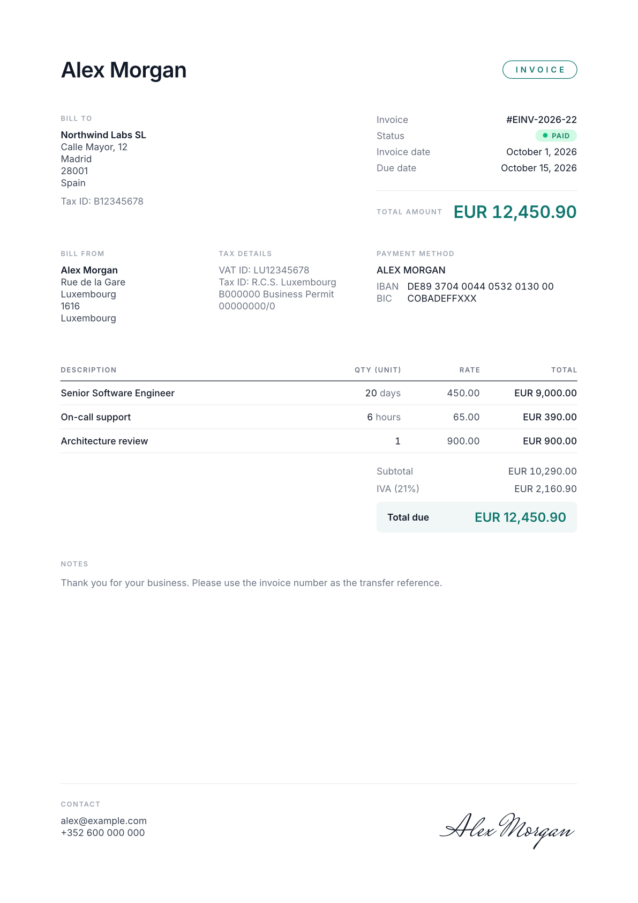

# invgen

[](https://github.com/ldolberg/invgen/actions/workflows/ci.yml)

Write invoices in markdown, get clean PDFs. A native desktop editor shows a live
preview as you type; a small CLI builds, watches and lists invoices from the
terminal. Your details, bank and clients live once in a config file, so each
invoice is a few lines.





**[User guide](https://ldolberg.github.io/invgen/guide/)** (install, config, format,
CLI, editor, recipes, FAQ) | [Contributing](CONTRIBUTING.md)

## Install

### Linux

Flatpak (any distro, auto-updates with `flatpak update`):

```sh
flatpak install --user https://ldolberg.github.io/invgen/io.github.ldolberg.invgen.flatpakref
```

The app reads the same `~/.config/invgen/config.yaml` as the native build and has
access to `~/Documents`; open files elsewhere through the file chooser. Install page:
<https://ldolberg.github.io/invgen/>.

Prebuilt (x86_64): grab `invgen-*-x86_64-linux.tar.gz` from
[Releases](https://github.com/ldolberg/invgen/releases), then

```sh
tar xzf invgen-*-x86_64-linux.tar.gz && ./invgen-*/install.sh
```

### macOS

Grab `invgen-*-macos-universal.zip` (Apple Silicon and Intel, macOS 11+) from
[Releases](https://github.com/ldolberg/invgen/releases), unzip it and put `invgen`
on your `PATH`. The binary is not notarized, so clear the quarantine flag once:

```sh
unzip invgen-*-macos-universal.zip && cd invgen-*-macos-universal
xattr -d com.apple.quarantine invgen
sudo install -m755 invgen /usr/local/bin/
```

The config lives in `~/Library/Application Support/invgen/config.yaml`.

### Windows

Grab `invgen-*-x86_64-windows.zip` from
[Releases](https://github.com/ldolberg/invgen/releases), unzip it and add the
folder to your `PATH` (or run `invgen.exe` from there). SmartScreen may warn about
an unsigned download; choose "More info" and "Run anyway". The config lives in
`%APPDATA%\invgen\config.yaml`.

### With Cargo (any platform)

```sh
cargo install invgen --locked
```

Needs Rust 1.95+ and a C compiler.

### From source

```sh
make install      # Linux: binary to ~/.local/bin, desktop entry and icon to ~/.local/share
make uninstall
```

Or just the binary: `cargo install --path . --locked`.

`invgen config` prints the config path on every platform. Paths below use the Linux
`~/.config/invgen` for brevity.

## Quickstart

Open the editor (`invgen`, or the app launcher). The first time, when there is no
config yet, it asks for your details, bank account and first client, writes a
commented `~/.config/invgen/config.yaml` and opens your first invoice, ready to
export. Prefer YAML? Pick "Skip, I'll edit YAML" and the commented template opens
in your text editor instead.

From the terminal:

```sh
invgen config --edit         # create ~/.config/invgen/config.yaml and fill in your data
invgen new --client acme     # writes ~/Documents/Invoices/INV-2026-01.md
invgen edit ~/Documents/Invoices/INV-2026-01.md   # editor with live preview
invgen build ~/Documents/Invoices/INV-2026-01.md  # -> INV-2026-01.pdf next to it
```

A full real-world config is in [`examples/config.yaml`](examples/config.yaml)
and sample invoices in [`examples/invoices/`](examples/invoices/).

| Command | What it does |
|---|---|
| `invgen` / `invgen edit [FILE]` | Open the editor |
| `invgen new [--client KEY] [--open]` | Create the next numbered invoice |
| `invgen new --from NUMBER\|last [--client KEY]` | Duplicate an invoice (items, notes, overrides) as the next one, with today's date and the period moved forward |
| `invgen build FILE.md [-o OUT.pdf] [--png DIR] [--strict]` | Render a PDF (and optional PNG previews). The first export of a non-draft invoice locks it (`issued_hash`); later builds warn when the issued content changed, `--strict` refuses |
| `invgen watch FILE.md` | Rebuild the PDF on every save |
| `invgen list [--year YYYY] [--client KEY\|NAME] [--status S]... [--unpaid]` | Table of the invoices (including subfolders) with yearly totals and the outstanding balance by age (not due yet, 1-30, 31-60, 61+ days late); pending invoices past due show as `overdue Nd`. Filters combine and totals respect them |
| `invgen list --format csv\|json` | Export the (filtered) invoices for accounting tools and scripts, see [docs/EXPORT.md](docs/EXPORT.md) |
| `invgen check [--strict]` | Check the library: duplicate numbers, gaps, dates out of order, files that fail to parse, missing client or sender tax data, issued invoices that changed. Exit 1 on errors (or warnings with `--strict`) |
| `invgen paid FILE\|NUMBER [--on DATE]` | Mark an invoice paid (`status: paid`, `paid_on`), editing only those lines |
| `invgen status FILE\|NUMBER STATUS` | Set the status: `pending`, `paid`, `overdue` or `draft` |
| `invgen send FILE\|NUMBER [--dry-run] [--mark-sent]` | Build the PDF if needed and open your mail client with the client's email, a subject and body from config templates, and the PDF attached (`xdg-email` on Linux; macOS Mail; Windows `mailto:` plus the PDF path). No SMTP, no stored credentials |
| `invgen config [--edit]` | Show (or edit) the config file |
| `invgen template --export [PATH] [--force]` | Write the built-in typst template (stdout without PATH) |

Every command accepts `--config PATH` (or `INVGEN_CONFIG=PATH`) to use another config.

In the editor, **Clients** (top bar) lists your clients and lets you add, edit,
rename and delete them; the arrow next to **New** starts an invoice for a chosen
client. These edits rewrite only the lines they change in `config.yaml`, so your
comments, key order and formatting stay as they are, and the previous version is
kept as `config.yaml.bak`. If the file uses YAML the editor cannot change safely
(for example a client written as a flow mapping `{ ... }`, or anchors), nothing is
written and the editor offers to open the file instead. Edits made in a text editor
are picked up when you save them.
Parse errors are reported as `file:line: message`.

## Format

```markdown
---
number: EINV-2026-23
date: 2026-11-02
due_days: 14
status: pending
client: northwind
---

| Description              | Qty | Unit | Rate   |
|--------------------------|-----|------|--------|
| Senior Software Engineer | 21  | days | 450.00 |

Any other paragraph becomes a note under the table.
```

Front matter holds the metadata (`client:` points into the config), the first
table holds the line items, and loose paragraphs become notes. List items
(`- Consulting: 21 days @ 450`) work instead of a table. Full spec:
[docs/FORMAT.md](docs/FORMAT.md). A `config:` block in the front matter overrides
any config key for a single invoice.

Lines can carry their own tax rate (a `Tax` column, or `- Training: 2 days @ 600, tax 10%`);
the totals then show one row per rate. `tax_note: reverse_charge` (also `exempt`,
`outside_scope` or free text; per invoice, per client or in the config) prints a
translated legal mention under the totals, and `invgen build` warns when an invoice
charges no tax to a client with a VAT ID and has no such note.

## Branding, languages and templates

```yaml
# config.yaml
language: es              # en, es, de, fr, it, pt, nl; also per client and per invoice
labels:
  bill_to: Cliente        # override any single label
from:
  logo: logo.svg          # SVG or PNG, top-left in the header; relative to the config file
template: my-invoice.typ  # optional: your own typst layout
payment:
  qr: true                # EPC (SEPA) QR code on EUR invoices, scannable by banking apps
```

`invgen template --export my-invoice.typ` writes the built-in template as a
starting point. The data a template receives is documented and versioned in
[docs/TEMPLATES.md](docs/TEMPLATES.md).

## Keyboard shortcuts

| Keys | Action |
|---|---|
| Ctrl+N | New invoice |
| Ctrl+O | Open |
| Ctrl+S | Save |
| Ctrl+E | Export PDF |
| Ctrl+= / Ctrl+- | Zoom preview in / out |
| Ctrl+0 | Reset zoom |

## Fuzzing

The parser runs on every keystroke in the editor, so it must return an error, never
panic, on any input. `cargo test` includes a property test for that
(`tests/parse_never_panics.rs`); for deeper runs there is a libFuzzer target
(needs nightly and `cargo install cargo-fuzz`):

```sh
cargo +nightly fuzz run parse -- -max_total_time=1800
```

It starts from the seeds in `fuzz/corpus/parse/` (the example invoices plus a few more)
and uses the fictional `examples/config.yaml`. Crashing inputs land in
`fuzz/artifacts/parse/`; add each one as a regression test in `src/parse.rs`.

## Releasing

Bump `version` in `Cargo.toml`, add a `<release>` entry to
`packaging/io.github.ldolberg.invgen.metainfo.xml` (and run `make flatpak-sources`
if `Cargo.lock` changed), commit, then push a matching tag:

```sh
git tag v0.1.3 && git push origin v0.1.3
```

The Release workflow tests the crate, builds the Linux tarball, the macOS and
Windows zips and the Flatpak (smoke testing each binary on its own OS), publishes
the signed Flatpak repo to GitHub Pages, creates the GitHub release and publishes
the crate to crates.io (secret `CARGO_REGISTRY_TOKEN`). Running it by hand from the
Actions tab is a dry run.
Build, test and coding rules: [CONTRIBUTING.md](CONTRIBUTING.md).

## License

MIT
