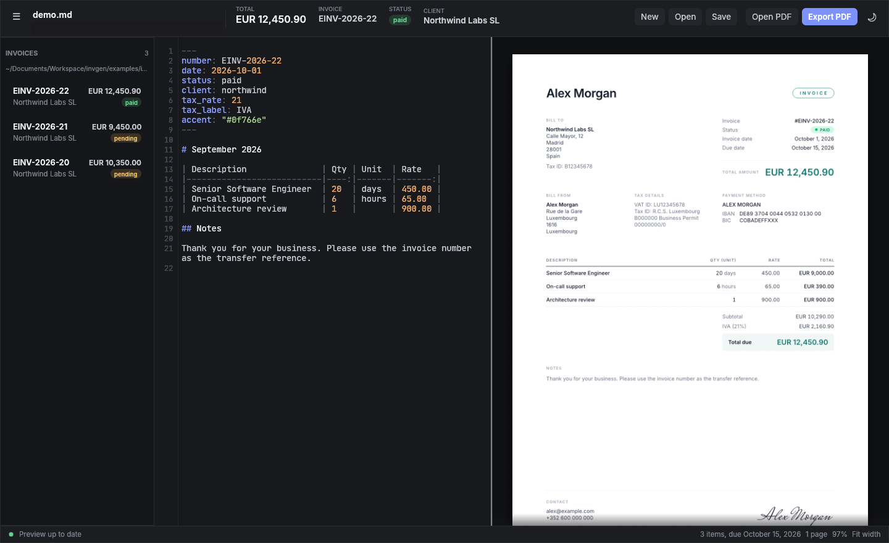

# The editor

`invgen` (or `invgen edit FILE`) opens a native window with three parts: the
invoice library on the left, the markdown editor in the middle and a live
preview of the PDF on the right.

## Keyboard shortcuts

| Keys | Action |
|---|---|
| Ctrl+N | New invoice with the next number |
| Ctrl+O | Open an invoice |
| Ctrl+S | Save |
| Shift+Ctrl+S | Save as |
| Ctrl+E | Export the PDF next to the markdown file |
| Shift+Ctrl+E | Export the PDF to a location you choose |
| Ctrl+B | Show or hide the invoice library |
| Ctrl+= (or Ctrl++) | Zoom the preview in |
| Ctrl+- | Zoom the preview out |
| Ctrl+0 | Fit the preview to the panel width |
| Ctrl+mouse wheel | Zoom the preview around the pointer |
| Ctrl+Space | Show completions at the cursor |
| Up / Down | Move through the completions |
| Enter or Tab | Accept the selected completion |
| Esc | Close the completions |

The toolbar buttons do the same things and show their shortcut on hover.

## Writing

The editor highlights the front matter, headings, tables, lists and numbers.
Write the invoice as described in [Invoice format](format.md); a new document
(Ctrl+N) starts from the same template as `invgen new`, for the first client in
your config.

Below the editor a status line reports the state of the preview:

- **Preview up to date** when the text parses and renders.
- **Line N: message** when there is a mistake. The line is highlighted in the
  editor; click the message to jump to it.

### Live check

A short moment after you stop typing, the editor checks the whole invoice and
marks every problem it finds, not only the first one:

- **Errors** (red) stop the invoice from rendering: an invalid `status`, a date
  that is not `YYYY-MM-DD`, an unknown `kind`, `language` or `locale`, a
  `client:` that is not in your config, an invalid `e_invoice` under `config:`,
  duplicate keys, item rows or list entries without a valid quantity or rate, a
  table without Description, Qty and Rate columns.
- **Warnings** (yellow) do not stop it: unknown keys (they are ignored; a close
  match is suggested, so `stauts` asks "did you mean `status`?"), config keys
  written at the top level instead of under `config:`, a `tax_note` that looks
  like a misspelled preset, a currency that is not a three-letter code, table
  rows with more or fewer cells than the header, a due date before the invoice
  date, a missing `tax_note` for a client with a VAT ID, and a payment QR code
  that cannot be printed.

Each line with a problem is underlined and tinted, gets a dot in the gutter and
shows the first message at its end. Hover the line (or its number) to read all
of its messages. A bar under the editor counts the problems; click it to open
the list, and click an entry to jump to its line.

### Completions

The editor suggests what fits where the cursor is:

- At the start of a line in the front matter: the keys you have not written yet
  at that level (top level, or inside `from:`, `to:`, `payment:`,
  `number_format:`, `config:` and a client under `config: clients:`).
- After `client:` the client keys from your config; after `status:`, `kind:`,
  `tax_note:`, `language:`, `locale:`, `currency:` and `e_invoice:` (under
  `config:`) their possible values; after `date:`, `paid_on:` and `due:` today's
  date (and for `due:` the date `due_days` from today); after `refers_to:` the
  invoice numbers in your library.
- In the body: item descriptions and units used in your library or set as client
  defaults, in the Description and Unit columns of the table and in list items
  (`- Description: 3 days @ 450`).

The list opens by itself while you type a word, and right after `key: `. Typing
narrows it down; Up and Down select, Enter or Tab accept, Esc closes it, and
Ctrl+Space opens it on demand. When it is closed, Enter and Tab behave as usual.
Accepting a key writes `key: ` and offers its values right away.

The window title shows a dot in front of the file name while there are unsaved
changes.

## Live preview

The preview re-renders shortly after you stop typing. It shows exactly what the
exported PDF will look like. While the text has an error, the last good preview
stays on screen with a banner that repeats the error, so the page does not
flicker while you type.

Above the preview a bar shows the invoice total, number, status and client, the
zoom level, a **Fit width** button and the page count. Drag the divider between
editor and preview to resize them; double click it to restore the default split.

## Saving and exporting

- **Save** (Ctrl+S) writes the markdown. A new, untitled invoice is saved
  straight into `invoices_dir` as `<number>.md` when that name is free;
  otherwise a save dialog opens.
- **Export PDF** (Ctrl+E) writes `<number>.pdf` next to the markdown file (or into
  `invoices_dir` for an untitled invoice). The file name always follows the
  number in the current text. Right click the button, or press Shift+Ctrl+E, to
  pick another location.
- **Open PDF** opens the last export in your PDF viewer. The notification shown
  after an export has an **Open** button too.
- **Send** exports the PDF, then opens your mail client with the client's email,
  a subject, a body and the PDF attached, like
  [`invgen send`](cli.md#invgen-send-filenumber---dry-run---mark-sent).

Exporting a non-draft invoice for the first time locks it: an `issued_hash` line
is added to its front matter (and to the file on disk). While an invoice is
locked, a banner above the editor reads "Issued invoice, edits change a sent
document"; it turns red when the invoice no longer matches what was exported,
because of an edit or a config change. **Unlock** removes the `issued_hash` line
(save to keep that); the next export locks the invoice again. Prefer a credit
note over editing an invoice you already sent.

Opening another file, starting a new one or closing the window with unsaved
changes asks whether to **Save**, **Discard** or **Cancel**.

## Invoice library

The sidebar lists the `.md` files directly inside `invoices_dir`, newest first,
with number, client, total and a colored status. Hover an entry to see its path
and date; click it to open it. Files that fail to parse are still listed, marked
"could not parse".

Right-click an entry for **Mark as paid**, **Set status** (pending, paid,
overdue, draft) and **Duplicate**. The status actions edit only the `status`
and `paid_on` lines of the file; if that file is open with unsaved changes,
nothing is written and a message asks you to save first. **Duplicate** works
like `invgen new --from` and opens the new invoice. The list refreshes when files in the folder change, including
changes made by other programs.

Toggle the sidebar with Ctrl+B or the button in the top left corner.

## Files changed outside the editor

If the open file changes on disk (for example after a `git pull`, or an edit in
another editor), invgen reloads it. If you have unsaved edits, it keeps your
edits and tells you the file changed on disk instead.

## Drag and drop

Drop a `.md`, `.markdown` or `.txt` file onto the window to open it.

## Themes and remembered settings

The theme button cycles between dark, light and following the system theme. The
editor remembers the theme, the split position, the zoom, whether the sidebar is
shown, the window size and the last opened file.

## Config

The editor reads the config once at startup. A broken config is reported in a
notification and the editor falls back to defaults. Restart the editor after
editing the config. It honors `--config` and `INVGEN_CONFIG` like the CLI.
