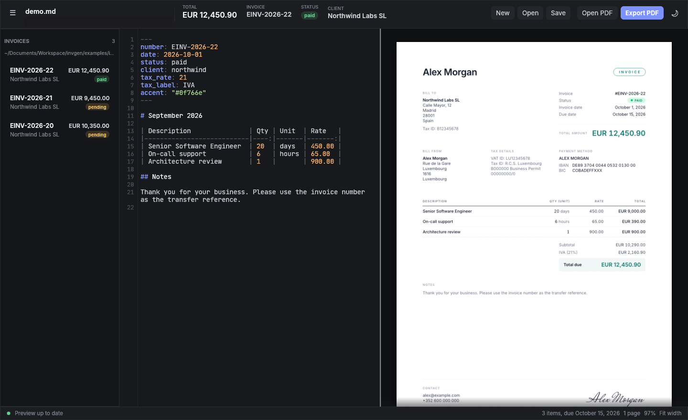

# Introduction

invgen turns invoices written in markdown into clean PDFs.

- **Your data lives once in a config file.** Who you are, your bank details and
  your clients go into `~/.config/invgen/config.yaml`. An invoice file only says
  what changes: the date, the client and the line items.
- **A native Linux editor** shows a live preview of the PDF as you type, lists
  your invoices in a sidebar and exports with one shortcut.
- **A small CLI** creates, builds, watches and lists invoices from the terminal,
  so invgen also fits scripts, Makefiles and your own text editor.
- **Plain text files.** Invoices are markdown with YAML front matter. They diff
  well, live happily in git and stay readable without invgen.

A complete invoice can be this short:

```markdown
---
number: EINV-2026-23
date: 2026-11-02
client: northwind
---

| Description              | Qty | Unit | Rate   |
|--------------------------|-----|------|--------|
| Senior Software Engineer | 21  | days | 450.00 |
```



## How this guide is organized

- [Install](install.md) and [Quickstart](quickstart.md) get you from nothing to a
  first PDF.
- The reference chapters describe the [configuration file](configuration.md), the
  [invoice format](format.md), every [command](cli.md) and the [editor](editor.md).
- The recipes show complete workflows, starting with
  [monthly billing for one client](recipes/monthly-billing.md).
- [FAQ and troubleshooting](faq.md) covers Flatpak file access, fonts and where
  the config lives.

invgen is MIT licensed. Source, issues and releases:
<https://github.com/ldolberg/invgen>. Want to help? Read
[CONTRIBUTING.md](https://github.com/ldolberg/invgen/blob/main/CONTRIBUTING.md).
